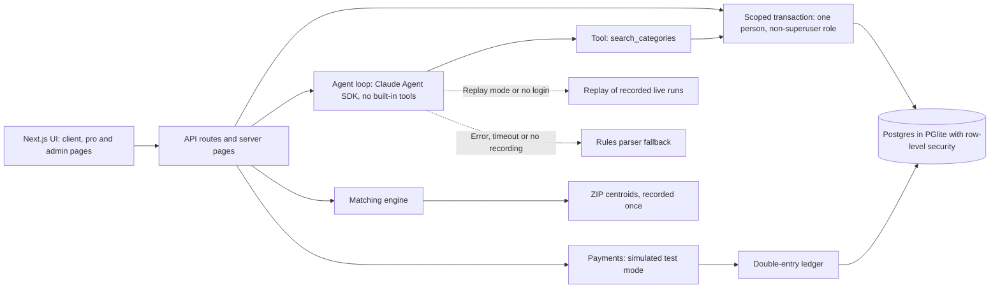
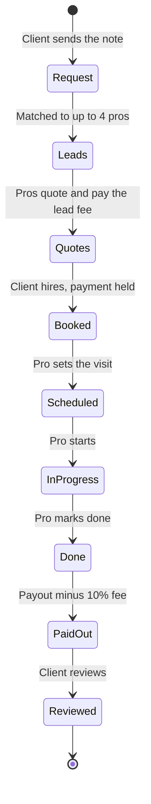
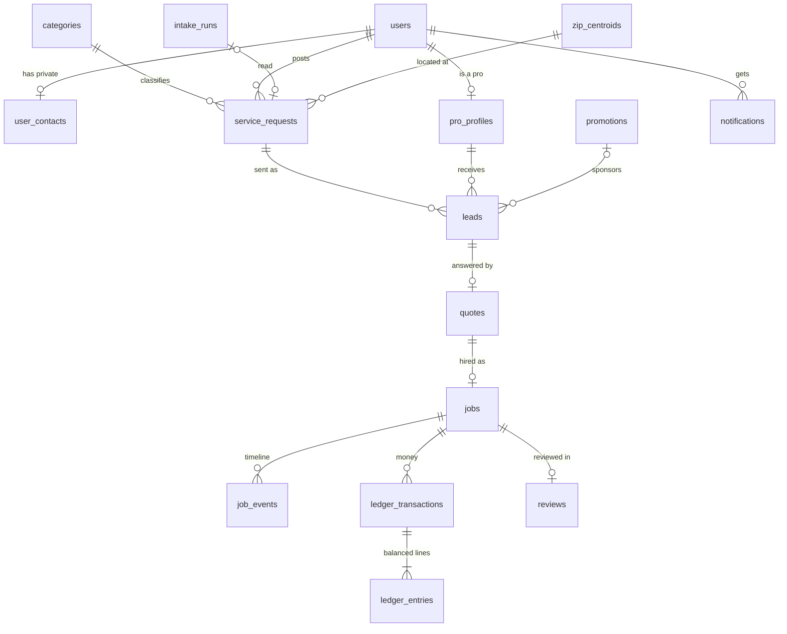

# Tradeloop

A working slice of a two-sided local services marketplace: a client describes a job in one sentence, the best-fit local pros get it and quote, the client hires, pays and reviews, and the team sees it all on an admin dashboard.


Full video: https://github.com/ArchiusVuong-sudo/local-services-marketplace/releases/download/v0.1/demo.mp4

## What it does

- A client types the job in their own words ("Water heater leaking in the garage, 85016. Need it fixed this week, budget about $450"). An intake agent turns it into an editable request (category, ZIP, timing, budget) and asks only the questions the note left open. "How this was read" shows the path, model, time, cost and each tool call.
- The request goes to the 4 best-fit pros nearby. Every match says why (serves the category, miles away, review score and count, reply time, availability). At most one card is a labelled Sponsored placement, and only for a verified pro that already passes the same bar.
- A pro works leads in an inbox that also fits a phone screen. Quoting spends prepaid lead credits. Phone numbers and emails typed in a quote stay masked, and the client's contact details stay hidden, until the client hires.
- The client compares quotes side by side and hires one. A simulated test-mode payment is held; the job moves Booked, Scheduled, In progress, Done with the same timeline and notifications on both sides. Done releases the payout minus a 10% platform fee, and the ledger lines show every transaction sums to $0.
- The client leaves a review. It shows first on the pro's profile and changes the pro's score for the next match.
- Admin sees the funnel, money through the platform, revenue split, median time to first quote, a weekly chart, sponsored placements with Pause, a ledger balance check, and a Data access page that counts the rows each person can read through the database's own policies.

## Architecture



Job lifecycle:



Data model:



## How it works

**Data and access.** Postgres runs in-process through PGlite (Postgres compiled to WASM, no Docker). Plain SQL migrations create 16 tables and row-level security policies. Every app request runs in one short transaction as the non-superuser role `app_user` with `app.user_id` set, so the database decides what each person can read or write: clients see their own requests, pros only the leads sent to them, contact details open only to the other side of a hired job, quotes can only be written by the lead's pro, and reviews only by the client of a done job, once. The unmasked quote message is a column the app role cannot select; a security-definer function returns it only to the pro and, after hire, the client. The UI's "Viewing as" switcher stands in for sign-in.

**Money.** All amounts are integer cents. Each money movement is a double-entry ledger transaction: credit purchase, lead fee, payment hold, payout release. Quoting spends the lead fee inside a database trigger, in the same transaction as the quote, so credits and the ledger cannot drift. A deferred constraint trigger refuses any transaction whose lines do not sum to zero at commit. Job status moves one step at a time, checked in code and again by a trigger.

**Matching.** One pure, deterministic function scores each eligible pro (serves the category, accepting leads, request ZIP inside the pro's radius): 40% review score, 25% distance, 20% reply time, 15% availability for the requested timing. The review score is a Bayesian average with a prior of 4.0 weighted as 8 reviews, so a 5.0 from 1 review (4.11) ranks below a 4.8 from 41 (4.67). Pros under a 0.45 relevance floor never get a lead. Three organic slots come first; the fourth may go to a sponsored pro only if it is verified, its promotion for that category is active and it passes the floor. Ties break by id, so the same input always gives the same order. Each lead stores its reason chips.

**Intake agent.** The Claude Agent SDK runs with every built-in Claude Code tool off (`tools: []`), no settings files, strict MCP config, no session saved, a fresh empty temp folder as cwd, at most 6 turns, permission mode `dontAsk` and an allowlisted child environment. It gets exactly one tool, `search_categories`, served in-process, which opens its own short read of the categories table. The answer comes back as `json_schema` structured output, then Zod checks it and the category and answer options are checked against the database before anything is shown. The note is wrapped as untrusted data in the prompt. Calls retry with backoff on overloaded, rate-limit and 5xx errors inside a 45 s budget, and no database transaction is held open during the call.

**Three paths, one interface.** The live agent and a replay provider share one interface. Replay uses runs recorded from the real live agent (`fixtures/intake-runs.json`, written by `npm run record:fixtures`) and re-runs the recorded tool calls against the database, so it needs no login, key or network. The app uses live when it finds a Claude Code login or `ANTHROPIC_API_KEY`, and replay when `DEMO_REPLAY=1` or nothing is found, with a "Replay mode" badge. If the live call fails, it falls back to the recording, and to a labelled rules parser (regular expressions and the same keyword search) when no recording exists. Every run is saved in `intake_runs`.

**Eval.** `npm run eval` scores intake on 12 synthetic notes, field by field. From the latest run:

| Path | Category | ZIP | Budget | Timing | Category, ZIP and budget all right |
|---|---|---|---|---|---|
| Rules parser | 11/12 | 12/12 | 11/12 | 12/12 | 10/12 |
| Recorded live agent runs (claude-sonnet-5-5) | 12/12 | 12/12 | 12/12 | 11/12 | 12/12 |

The rules parser misses "twelve hundred dollars" and reads "weekly pool cleaning" as house cleaning. The agent's one timing miss is a flooding yard it marked as urgent where the note gave no time. Recorded live runs took 5.1 to 9.0 s and cost about $0.006 to $0.008 each (the SDK's own estimate).

**Synthetic history.** A seeded generator replays eight weeks of marketplace activity (about 160 requests) in time order through the same services the app uses, as each person under the same policies, so leads, quotes, jobs, payments, reviews, notifications and the ledger all agree. Reviews from before that window are added as labelled imported reviews so each pro starts at its listed score.

**Trade-offs.** PGlite keeps the demo to one `npm install` and gives real Postgres policies, but it runs one transaction at a time in one process; production would use a managed Postgres with the same migrations and policies. Payments are a ledger in test mode with no gateway, which keeps the money logic testable now and maps onto a payment provider with marketplace payouts later. Matching is a transparent weighted score rather than a learned model, so every lead can explain itself to the client and the pro.

## Run it

Needs Node 22 or newer.

```bash
npm ci
npm run build
npm start                 # http://127.0.0.1:4111
```

- Live intake uses your local Claude Code login (or set `ANTHROPIC_API_KEY`).
- Replay mode, no login or key: `DEMO_REPLAY=1 npm start`.
- Clean data: the Demo menu's Reset item, or `npm run reset`.
- Drive the whole lifecycle over HTTP against the running app: `npm run flow`.
- Record fresh fixtures from live runs: `npm run record:fixtures`. Score intake: `npm run eval`.

Environment variables (see `.env.example`):

| Variable | Default | What it does |
|---|---|---|
| `PORT` | `4111` | Port for `npm start` (binds 127.0.0.1) |
| `INTAKE_MODEL` | `claude-sonnet-5-5` | Model for the intake agent (`claude-opus-5-5`, `claude-haiku-5-5` also work) |
| `DEMO_REPLAY` | unset | `1` forces replay mode |
| `INTAKE_MODE` | automatic | `live`, `replay` or `rules` |
| `INTAKE_TIMEOUT_S` | `45` | Seconds before a live call falls back |
| `ANTHROPIC_API_KEY` | unset | Use a key instead of the local login |
| `DATA_DIR` | `./data/pg` | Where the file-backed database lives |

## Tests

```bash
npm test                  # unit and database tests, replay mode, no network
npm run test:e2e          # builds, starts the app in replay mode, walks the main flow in headless Chrome
LIVE=1 npm run test:live  # opt-in smoke test against the real agent
npm run typecheck
```

- Matching: wrong-category and out-of-area pros never match, a sponsored pro under the floor, paused or unverified never shows, one 5-star review ranks below 41 good ones, the same input always gives the same order.
- Masking: phone and email formats are hidden; prices, times, dates and ZIP codes stay.
- Row-level security, against a real Postgres: another pro's leads, quotes and the client's contact return 0 rows, forged quote and review inserts are refused, contact details open only after hire, illegal status jumps and unbalanced ledger transactions are refused by the database.
- Lifecycle: note to request to quote to hire to payout to review; credits drop by exactly the lead fee; every ledger transaction and the whole ledger sum to zero; payout equals price minus fee; the review changes the next match score.
- Admin: dashboard numbers equal a direct SQL recount; pausing a promotion stops it matching; the data access matrix matches per-person counts.
- Intake: the rules parser gets 10 of 12 notes right; output schema checks; replay of every recorded run; the agent's environment allowlist and retry rules.
- End to end (Playwright): the whole main flow in the browser in replay mode, with no console errors.

The e2e test uses the installed Chrome by default; set `PW_CHANNEL=chromium` after `npx playwright install chromium` to use a bundled browser.

## Notes

- All people, businesses, reviews, payments and numbers are synthetic and labelled as such in the app. Payments are simulated test-mode ledger entries; no card is charged and no payment provider is called. ZIP centroids were recorded once from the keyless public api.zippopotam.us.
- There is no hosted demo on purpose: the live intake path runs on the visitor's own Claude Code login or API key, or in replay mode.
- A production version would add real accounts and sessions (email, phone and social sign-in) in place of the "Viewing as" switcher, mapped onto the same database policies.
- It would also add a payment provider with marketplace payouts, pro onboarding with license and insurance checks behind the Verified badge, and refunds and disputes in the ledger.
- And: messaging between client and pro, email and push notifications, a public browse and search page per category and city, a React Native app sharing the TypeScript domain code, and a managed Postgres with background jobs for reminders and payout timing.
